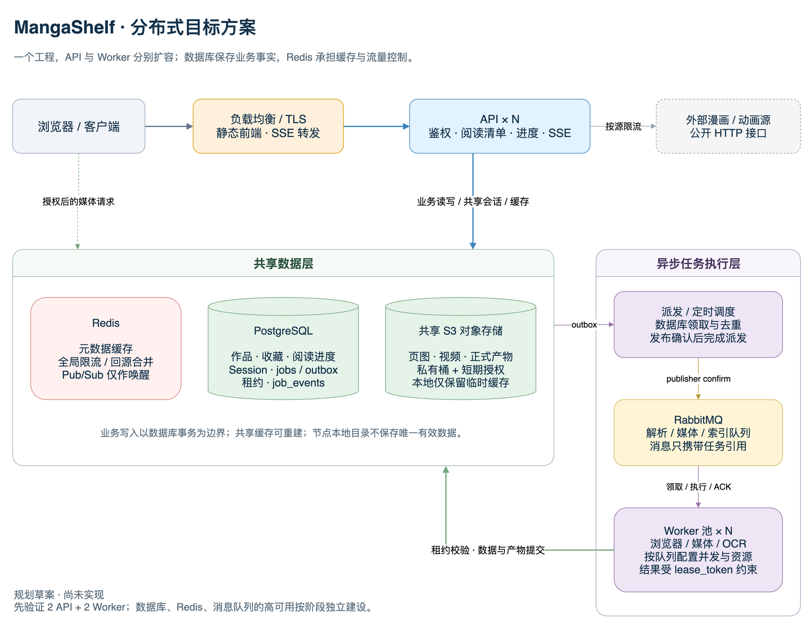

# MangaShelf 分布式演进与功能收敛方案

- 状态：草案，未实现
- 审查基线：`main` `cb5b627`（2026-11-12）
- 设计依据：[DESIGN.md](DESIGN.md) 第 6、11、15、20 节
- 目标图：[distributed-evolution.drawio](distributed-evolution.drawio) / [distributed-evolution.png](distributed-evolution.png)

本文只记录增量决策与实施顺序，不替代 `DESIGN.md`。内容分为两部分：

1. 分布式目标架构：请求可以落到任意 API，任务可以由任意 Worker 接手，应用节点退出后阅读、进度和任务仍能继续。
2. 功能模块收敛：哪些旧实现应退役、哪些功能应合并、哪些能力应改为可选、哪些问题必须先修。

## 1. 结论

- 继续保留“一个 Java 工程、API 与 Worker 两种运行角色”，不拆微服务。
- 第一阶段先验证 **2 个 API + 2 个 Worker** 的多实例正确性，再考虑跨机器和基础设施高可用。
- PostgreSQL 继续保存业务事实、会话、任务、租约和事件；RabbitMQ 只负责通知。
- Redis 进入目标架构，承担共享元数据缓存、全局限流、减少重复回源和 SSE 唤醒；不把业务事实放入 Redis。
- 图片和正式处理产物进入共享 S3 兼容存储；节点本地目录只保留临时文件和可重建缓存。
- 功能上先清理旧截图、旧跨源桥接、旧派生链路和重复入口，再修收藏、历史、搜索和内容归属。
- AI 检索、OCR、RAG 问答、弹幕和浏览器型数据源改为按场景启用，不阻塞基础阅读与播放。

## 2. 目标架构

### 2.1 状态归属

| 组件 | 负责内容 | 扩容原则 |
| --- | --- | --- |
| 负载均衡 | HTTPS、静态前端、API 转发、SSE 转发 | API 实例可以随时加入或摘除 |
| API | 鉴权、目录、阅读清单、收藏进度、媒体授权 | 请求不能依赖某台机器的内存或文件才能完成 |
| Worker | 浏览器解析、分页、媒体核验、OCR、索引 | 按任务类型、CPU 和内存需求分别扩容 |
| PostgreSQL | 业务数据、Session、任务、租约、事件、outbox | 第一阶段保留单一写入入口 |
| Redis | 共享元数据缓存、全局限流、减少重复回源 | 缓存可重建，故障行为明确 |
| RabbitMQ | 通知 Worker 有任务可领取 | 数据库任务记录仍是事实 |
| S3 兼容存储 | 页图、视频、正式处理产物 | 所有应用节点访问同一份对象 |

### 2.2 Redis 的边界

第一批只接入以下能力：

- 共享元数据缓存：榜单、首页分区、作品详情、章节索引。
- 全局限流：用户请求频率、单个上游源的总请求频率。
- 重复回源合并：同一章节被并发打开时，尽量共享一次加载结果。
- SSE 唤醒通知：有新任务事件时通知各 API 去数据库补读。

缓存键至少包含数据源、资源 ID、语言、清单或规则版本。依赖登录态的数据还要包含账号范围或凭据配置版本；原始 Cookie 不进入 key。

缓存策略：

- 先以 Redis 为主要共享缓存，本地只保留少量有界缓存和当前执行中的请求。
- 作品权限、下架状态和媒体授权必须实时校验，不能依赖长时间缓存的页面结果。
- Session 初期继续使用 Spring Session JDBC，不为多 API 实例立即迁移到 Redis。
- Redis 设置明确的内存上限、TTL 和淘汰策略；内存满时的拒绝写入要有受控处理。
- 缓存故障时允许受控回源；昂贵解析的全局限流不可用时明确返回繁忙，避免所有节点同时冲击上游。

### 2.3 阅读、媒体与推送

漫画阅读链路：

1. API 返回完整章节索引和稳定页码。
2. 浏览器按阅读位置请求页图。
3. 页图命中共享对象存储时直接读取；未命中时受控下载、校验后保存。
4. 本机磁盘只作为加速缓存，清空后仍能恢复阅读。

站内私有媒体继续由 API 鉴权后签发短期访问地址，让对象存储承担主要传输。预签名 URL 本身具有访问能力，必须保护好并明确过期边界。

SSE 继续以数据库 `job_events` 为依据：客户端重连到另一个 API 后，用 `Last-Event-ID` 或 `after_sequence` 补读。Redis Pub/Sub 只负责唤醒，不承担事件存储；断线期间的通知不依赖重放。

## 3. 分布式任务系统

现有 `jobs + outbox_events + job_events + lease_token` 方向正确，但以下边界需要先补齐：

| 当前实现 | 目标设计 |
| --- | --- |
| outbox 读取事务结束后才开始发消息 | 短事务领取并记录派发租约；发送结束后按领取令牌更新，超时可回收 |
| 租约恢复先把任务改成 QUEUED，再另行写 outbox | 状态恢复、派发记录和恢复事件在同一事务内提交 |
| `lease_token` 只保护最后的 `jobs` 状态更新 | 页面清单、解析结果、索引激活等业务写入也必须受租约校验保护 |
| 章节处理事务里包含对象上传 | 先上传 attempt 独立产物，再用短事务校验租约并切换有效引用 |
| 事件序号通过 `MAX(sequence) + 1` 分配 | 在数据库中串行分配，避免恢复器与 Worker 并发冲突 |

### 3.1 队列拆分

当前派发器实际把消息统一发往 `content.process`。目标按资源特征拆成三组：

| 队列 | 任务 | Worker 特征 |
| --- | --- | --- |
| `content.resolve` | 外部解析、浏览器嗅探 | 控制浏览器数量和上游访问量 |
| `content.process` | 分页、媒体核验 | 控制文件处理和 FFmpeg 并发 |
| `content.index` | OCR、Embedding、索引 | 控制模型内存和 CPU 使用 |

同一套 Worker 代码通过配置选择消费队列。任务提交成功后再 ACK；发布确认和消费确认分别处理，接受重复通知，通过数据库保证幂等提交。

### 3.2 多实例原则

- Worker 通过条件更新取得任务租约，重复通知读到终态或有效租约时不重复执行。
- 提交结果必须同时匹配任务状态和租约令牌；过期 Worker 不能覆盖新 attempt。
- 租约恢复在事务内判断 attempt 上限并创建新的待派发记录；超限任务等待显式重跑。
- 不使用“所有 Exception 自动重试”；权限、格式和参数错误直接失败。
- 可重复执行的阶段用业务任务键和产物摘要复用，不重复产生费用或重复覆盖有效结果。

## 4. 功能模块取舍

### 4.1 应退役的旧实现

| 项目 | 当前情况 | 建议 |
| --- | --- | --- |
| 哔哩截图阅读链路 | Java 截图入口已返回 410，Python 仍保留 canvas 截图模式及测试 | HTTP 阅读验收后删除旧截图实现，短期保留 410 处理旧链接 |
| 旧自动跨源桥接 | `MangaMatcher.findReadable()` 当前没有调用方，但仍保留客户端依赖和缓存 | 删除未使用的自动桥接部分；保留综合榜仍在使用的相似度函数 |
| 早期单图派生任务 | 当前上传核验不再自动派生 `content.process`，正常章节处理走 `chapter.parse` | 核对历史待处理任务后退役 `DeriveJobHandler`，减少重复图片处理链路 |
| “旧版书库”独立入口 | 导航仍提供旧版书库，同时存在漫画专区、番剧索引和我的收藏 | 迁移必要的管理操作后取消重复入口 |

退役旧实现不等于删除对应业务能力。例如删除旧单图任务，不影响漫画上传、分页和缩略图。

### 4.2 应合并的重复实现

**外部漫画统一接口协议**

当前同时存在 `/api/v1/external-manga/...` 和 `/api/v1/manga-sources/{source}/...`。`MangaDexSource` 已接入统一数据源接口，前端仍对 MangaDex 单独分支。

建议逐步统一到 `manga-sources`：各源内部保留自己的 HTTP 客户端，外部共用详情、章节和页图响应。图片代理独立保留，旧接口在调用迁移后退役。

**两套外部动画观看页面**

目录浏览态播放和加入书库后的播放分别使用 `BrowseWatch`、`ExternalWatch`，解析、选集、线路切换和错误处理存在重复。

建议保留两种内容归属，但共用播放服务和播放器页面逻辑，使续播和解析修复一次覆盖两个入口。

**缓存、限流和上游访问规则**

各源自行维护 Map、磁盘缓存、Semaphore 和超时。分布式改造时统一缓存键、容量、失效、并发和错误规则；各源只负责具体接口和解析差异，不继续扩张通用规则引擎。

### 4.3 应改为可选的能力

| 功能 | 取舍建议 | 原因 |
| --- | --- | --- |
| 语义搜索 / Embedding | 独立开关，普通标题搜索不强制运行模型 | 当前普通搜索在模型启用后会同步计算向量 |
| OCR 索引 | 保留，仅对需要检索的本地章节按需构建 | 阅读、播放本身不依赖 OCR |
| RAG 问答 | 暂缓扩展，先完成可用搜索 | 当前有后端入口，网页端尚未形成问答交互 |
| 弹幕 | 可选功能，暂不优先扩展 | 不直接改善阅读、解析或续播 |
| 综合榜跨源融合 | 简化为缓存结果或后台计算 | 页面请求不必等待所有源完成融合和标题匹配 |
| 仅支持浏览器的数据源 | 保留为可选源，独立 Worker 执行 | 首页和 API 的基础运行不应依赖 Chromium |

MangaWeaver 接入、上传和发布是原始设计要求的业务闭环，不直接删除。若近期主要投入阅读聚合，可以把创作管理入口和处理任务作为可选能力保留。

### 4.4 必须优先修正的功能问题

**收藏、历史和继续阅读混在一起**

当前“我的收藏”把本地作品收藏、外部漫画阅读记录和动漫观看历史放进同一页面；动漫标签实际读取 `watch-history`，外部漫画读取 `manga-progress`。浏览过的内容会出现在收藏页，却没有对应收藏关系和取消收藏操作。

建议明确分开：

| 功能 | 用户行为 | 数据含义 |
| --- | --- | --- |
| 我的收藏 | 主动收藏、取消收藏 | 用户与作品的收藏关系 |
| 历史记录 | 阅读、播放后产生 | 最近访问或消费记录 |
| 继续阅读／观看 | 从进度中计算 | 每部作品最近可恢复的位置 |

收藏需要支持本地作品、外部漫画和外部番剧。可以统一列表响应和服务入口，数据库仍使用明确的目标约束，避免做成任意字符串引用的通用资源表。

**普通播放不应强制转成本地作品**

当前已有浏览态播放，但新番时刻表点击播放时仍调用 `materialize` 创建作品；物化逻辑还会把公共目录条目关联到某个用户创建的作品上，使公共目录和用户所有权耦合。

建议：

- 普通播放直接使用目录条目和剧集。
- 收藏建立用户关系。
- 只有明确导入、编辑或发布时，才创建用户拥有的站内作品。

**搜索先统一功能，再加强语义能力**

当前全站搜索和外部漫画搜索分开；全站搜索页组合番剧目录与站内内容，外部漫画另走入口。前端发送 `hasAnimation`，后端读取 `withAnimation`，“只看有动画的”筛选没有按预期传递。

建议统一搜索入口，明确番剧、漫画、站内素材的范围。标题检索作为默认路径，对白和语义检索作为明确模式，慢源不能拖住全部结果。

**进度冲突规则需要统一**

本地阅读进度有版本冲突控制，外部漫画目前直接覆盖。多设备同时阅读时，后到的旧请求可能覆盖新进度。

建议统一进度服务的冲突语义、按作品查询续读目标和批量列表响应；漫画页码与视频时间保留各自字段，不强行合并成一张万能表。

### 4.5 保留的核心模块

收敛后保留的核心范围：

- 账号与权限
- 内容目录
- 阅读与播放
- 个人收藏、历史与进度
- 数据源接入
- 任务与资产
- MangaWeaver 接入、上传与发布（按场景启用）

## 5. 分阶段落地

### 第一阶段：支持多实例

范围：

- 任务事务、outbox 领取、租约恢复和业务写入边界修复。
- Redis 元数据缓存、全局限流和回源合并。
- 共享页图存储，本地目录降为临时缓存。
- 浏览器解析移入 Worker，队列按任务类型拆分。
- 收藏、历史、搜索筛选和进度冲突修复。

验收：

- 启动 2 个 API、2 个 Worker，交替请求和并发任务结果正确。
- 同一个任务重复通知不重复提交页面或版本。
- API 或 Worker 中途退出后，任务可以恢复且旧 attempt 不覆盖新结果。
- 页图缓存命中、未命中、上游失败和缓存故障行为明确可见。

### 第二阶段：跨机器部署

范围：

- API、Worker、数据服务、Redis、RabbitMQ 和对象存储分开部署。
- 同一次构建产出固定镜像版本，API 与 Worker 一起发布。
- Flyway 作为单独部署步骤执行；扩容前核算所有实例连接池的总连接数。
- 统一配置、日志、指标和任务追踪。

验收：

- 配置独立负载均衡入口或完成入口切换后，关闭任一应用节点，会话、续读、SSE 和任务可以恢复；入口与应用共机时，需单独演练入口故障。
- 新节点加入后无需人工迁移本地状态即可提供服务。
- 对象存储和数据库故障时错误明确，不出现静默成功。

### 第三阶段：基础设施高可用

范围：

- 数据库故障切换、Redis 高可用、RabbitMQ quorum queues 和存储冗余。
- 容量、备份、恢复时间和故障演练。

验收：

- 演练数据服务故障和恢复，记录实际恢复时间与数据边界。
- 不以“组件有副本”代替真实切换验证。

## 6. 验收清单

| 场景 | 验收标准 |
| --- | --- |
| 多 API 交替请求 | 登录、收藏、进度、阅读清单一致 |
| API 重启后的 SSE | 客户端用事件游标重连并补齐事件 |
| Worker 中途退出 | 租约恢复后完成或明确失败，旧 attempt 不覆盖新结果 |
| 重复队列消息 | 不重复提交页面或版本 |
| Redis 不可用 | 缓存请求受控回源或明确繁忙，业务事实不丢失 |
| 页图缓存 | 命中、未命中、上游失败和磁盘清理行为可观察 |
| 收藏与历史 | 浏览不产生收藏；收藏有明确取消操作；历史与续读分开展示 |
| 时刻表播放 | 不创建用户作品即可播放；收藏是独立操作 |
| 搜索筛选 | “只看有动画”实际生效，慢源不阻塞基础结果 |
| 多设备进度 | 冲突返回明确快照，不静默覆盖新进度 |

## 7. 风险与待决策

- Redis 单点故障时的回源压力和限流降级策略。
- PostgreSQL 的连接数、写入容量和备份恢复时间。
- 共享对象存储的带宽、签名有效期和跨节点缓存一致性。
- 浏览器型数据源的上游限制、合规边界和资源占用。
- 旧本地缓存、历史任务和旧接口调用的迁移与清理窗口。
- 多实例下定时任务是否需要选主，或改为数据库条件领取。

## 8. 审查证据索引

以下为本次审查涉及的主要代码位置，供后续变更拆分和验证使用：

- `server/src/main/java/com/mangashelf/ingestion/OutboxRepository.java`
- `server/src/main/java/com/mangashelf/ingestion/LeaseRecoveryScanner.java`
- `server/src/main/java/com/mangashelf/ingestion/JobExecutor.java`
- `server/src/main/java/com/mangashelf/ingestion/ChapterParseHandler.java`
- `server/src/main/java/com/mangashelf/ingestion/JobDispatcher.java`
- `server/src/main/java/com/mangashelf/external/manga/BilibiliReaderService.java`
- `server/src/main/java/com/mangashelf/external/manga/MangaBrowserResolveService.java`
- `server/src/main/java/com/mangashelf/external/manga/MangaMatcher.java`
- `server/src/main/java/com/mangashelf/retrieval/SearchService.java`
- `server/src/main/java/com/mangashelf/retrieval/SearchController.java`
- `server/src/main/java/com/mangashelf/external/ExternalCatalogService.java`
- `server/src/main/java/com/mangashelf/external/manga/ExternalMangaController.java`
- `processing/tasks/manga_resolve.py`
- `web/src/pages/Shelf.tsx`
- `web/src/pages/Search.tsx`
- `web/src/pages/Schedule.tsx`
- `web/src/pages/ExternalMangaDetail.tsx`
- `web/src/pages/ExternalMangaReader.tsx`
- `web/src/App.tsx`

## 9. 2026-11-12 补充：服务器数量、部署拓扑与 Kubernetes

本节补充物理部署规划，对应 `DESIGN.md` 第 6、20、21 节。以下均为设计建议，未完成跨机部署、Kubernetes 部署或容量实测；配置规格是验证起点，不代表吞吐量承诺。现有架构图表达组件关系，服务器放置以本节为准。

### 9.1 当前配置能做到哪一步

现有 `compose.yaml` 与 `deploy/compose.prod.yaml` 面向单机：API 连接 `db`、`rabbitmq`、`storage` 这些本机容器服务名，Web 也只向 `api:8080` 转发；生产覆盖层没有把 API 和数据服务端口绑定到跨机可达地址。目前没有 Redis 服务、跨机负载均衡配置或 Kubernetes 清单。

因此，当前执行 `docker compose up` 不能自动得到跨机器部署。普通 Compose 管理一个 Docker 主机上的容器；采用多机 Compose 时，需要在每台机器分别启动对应服务，并自行配置私网通信、入口、发布和故障切换。[D1][D2]

### 9.2 需要几台服务器

| 方案 | 自管服务器数量 | 服务分配 | 适用范围和故障边界 |
| --- | --- | --- | --- |
| 单机运行 | 1 台 | Web、API、Worker 和数据服务共机 | 验证完整业务；单机多个实例不能抵御宿主机故障 |
| 两机试运行 | 2 台 | A：入口、API、PostgreSQL、Redis、RabbitMQ；B：API、Worker；对象使用外部 S3 | 验证跨机请求与任务；A 故障会影响全站，B 故障期间后台任务暂停 |
| 三机应用冗余，推荐起点 | 3 台 | A、B：各 1 个 API 和 1 个轻量 Worker；C：PostgreSQL、Redis、RabbitMQ；对象使用外部 S3 | 两个应用节点可以互相接手；需独立入口或入口切换，C 仍是数据单点 |
| 托管数据服务 | 2 台应用服务器，加外部托管服务 | A、B：API、Worker；外部服务：数据库、缓存、队列、对象存储和负载均衡 | 自管机器较少，但托管服务另收费，其高可用能力需按实际配置核对 |
| 自建整站高可用 | 按故障域另行规划 | 应用、入口、数据库、缓存、队列、对象存储分别配置冗余 | 不能根据“已有三台机器”推断整站高可用，需要逐个组件做切换演练 |

建议先完成单机多实例验证，再按预算选择两机试运行或三机应用冗余。服务器不必一组件一台，初期可以共机；需要避免昂贵 Worker 挤占在线请求和数据库资源。

### 9.3 三机方案具体怎么放

下面是推荐的首轮跨机验证配置，假设以阅读、播放和 HTTP 数据源为主，浏览器任务低并发，暂不运行持续的大规模 OCR、Embedding 或视频转码：

| 节点 | 规划规格，未经实测 | 进程与数据 | 初期限制 |
| --- | --- | --- | --- |
| A，应用节点 | 4 vCPU / 8 GB RAM | Web、API-1、Worker-1；无独占业务数据 | Worker 并发先设为 1，为 API、操作系统和临时文件留资源 |
| B，应用节点 | 4 vCPU / 8 GB RAM | Web、API-2、Worker-2；无独占业务数据 | 与 A 同版本；两个 Worker 总并发先限制为 2 |
| C，数据节点 | 4 vCPU / 8 GB RAM，SSD | PostgreSQL、Redis、RabbitMQ 与持久卷 | Redis、数据库和队列分别设资源边界；备份另存到节点外 |
| 外部服务 | 单独核算费用和可用性 | S3 兼容对象存储；可选独立负载均衡 | 图片和视频流量单独估算；独立负载均衡不计为上述三台虚拟机 |

这相当于自管部分共 12 vCPU / 24 GB RAM，是便于验证和隔离资源的预算草案，不能据此承诺在线人数。

入口有两种选择：

- 节省成本：Caddy/Nginx 放在 A，转发到 A、B 的 API。API-1 退出可以切到 API-2，但 A 整机退出会同时丢失入口。需接受人工入口切换和相应停机时间。
- 需要自动绕过应用节点故障：使用带健康检查的独立负载均衡入口，将流量发到 A、B；入口自身的可用性也需验证。不要用普通 DNS 轮询代替完整的健康检查和切换方案。

C 上的数据服务仍然是单点。如果 C 故障，两个 API 副本不能维持完整业务；缓存冗余、数据库故障切换、队列冗余和对象存储冗余属于下一阶段工作。

如果只拿到一台 4 核 4 GB 的机器，先按轻量单机验证：关闭可选模型与重处理能力，限制 Worker 并发并监测内存。不要同时把双 API、双 Worker 和 Kubernetes 高可用作为这台机器的验收目标。是否需要扩容，以容器实际内存、任务峰值和页面响应测量决定。

### 9.4 不用 Kubernetes，分布式怎么落地

第一轮采用每机 Docker Compose，加私网地址和明确的服务清单。Compose 不负责跨机器调度；节点上的容器重启由本机管理，跨机接管由应用的共享状态、任务租约和入口配置完成。[D1][D2]

落地顺序：

1. **先修应用共享状态。** 完成第 2、3 节的共享缓存、对象存储、任务事务和租约边界；登录继续使用共享 PostgreSQL 中的 Session。请求和任务不能依赖原节点的本地文件才能完成。
2. **准备网络。** A、B、C 放在同地域、低延迟私网中；跨服务商或自有电脑接入时先建立受控隧道，再验证延迟、吞吐和断线恢复。公网只提供站点入口，数据服务绑定私网并只允许指定节点访问；远程维护入口单独限制。
3. **准备数据节点。** C 启动 PostgreSQL、Redis、RabbitMQ，配置持久卷、账号权限、资源上限与异机备份。A、B 的连接地址指向 C 的私网地址或内部 DNS，不能继续使用本机 Compose 网络里的服务名。
4. **统一对象访问。** 两台应用连接同一桶，正式产物写入 S3；Worker 本地目录只用于单次处理。浏览器必须能访问签名地址，或经统一媒体域名代理；代理需保持签名所依赖的 Host 与路径，不能只替换地址。现有 `/media/` 对 `storage:9000` 的转发也需要对应调整。
5. **构建一次，发布相同产物。** 在开发机或 CI 构建 Web、API、Worker 镜像，推到可访问的镜像仓库；A、B 拉取同一版本或 digest。若混用 ARM 与 x86，需分别构建并验证兼容镜像及原生依赖。
6. **迁移只执行一次。** 使用单独部署步骤执行 Flyway，成功后启动 API、Worker；普通副本不承担迁移。当前迁移由 API 启动触发，这一步需要改造，不能把原配置直接复制两份就视为完成。
7. **接入负载均衡。** Web/API 保持同源，两个 API 配置相同站点身份和会话规则；共享 Session 后不依赖粘性会话。入口配置健康检查、SSE 长连接和转发头处理，确保浏览器重连到另一 API 时可以补读事件。
8. **做故障验收再扩大并发。** 分别退出 API、杀死 Worker、重启节点、清理本地缓存、暂停 Redis；验证续读、事件补读、任务恢复与错误提示。最后才提高 Worker 并发和缓存容量。

后续实施时按节点拆分部署文件，明确 `app` 与 `data` 的服务集合；当前文档不新增尚未验证的部署命令或空配置。

### 9.5 要不要加入 Kubernetes

**当前业务部署先用 Compose；需要学习 Kubernetes，或确实出现跨节点自动调度和频繁发布需求时，再单独引入 K3s 或托管 Kubernetes。** 这是本项目的阶段性建议，延续 `DESIGN.md` 第 6.2 节“不默认引入 Kubernetes”的原则。

Kubernetes 提供应用副本管理和调度能力；生产高可用仍需分别规划控制平面、副本放置、流量入口和数据服务。单机集群仍存在单机故障点，多个副本也需要跨故障域放置。[D3][D5]

| 当前需求 | 选择建议 |
| --- | --- |
| 只有一台服务器，先完成阅读与播放 | Compose |
| 两三台服务器，实例数量固定、发布频率低 | 各机 Compose，显式配置入口与私网通信 |
| 明确希望练习 Kubernetes 的部署、探针、调度和恢复 | 可以用 K3s 建独立实验环境，记录实验范围 |
| 经常扩缩容，节点故障后要自动重新放置任务进程 | 评估 K3s 或托管 Kubernetes，并预留故障后的剩余容量 |
| 目标是整站高可用 | 同时解决入口、数据库、队列和存储，不能只增加 Kubernetes 副本 |

不能单凭服务器台数决定是否上 Kubernetes。对本项目更有意义的触发条件是：手工多机发布与恢复已经成为负担、需要自动调度，且有人持续维护集群升级、证书、网络、存储和备份。

### 9.6 如果选择 K3s，需要几台机器

以下区分的是 Kubernetes 节点数量，与应用中负责处理漫画的 Worker 进程不是同一个概念：

| K3s 方案 | 节点分配 | 能验证什么 | 故障边界 |
| --- | --- | --- | --- |
| 单节点实验 | 1 台 server，兼跑业务 | 镜像、Deployment、Service、探针和发布流程 | 整机退出后集群和业务都不可用 |
| 多节点实验 | 1 台 server + 2 台 agent | 多节点调度、应用副本分散与重建 | 单 server 的控制平面是单点，不能称为控制平面高可用 |
| 内嵌 etcd 的高可用控制平面 | 3 台 server，可按资源情况兼跑业务；agent 按需增加 | 控制平面节点故障后的继续管理和调度 | 三台需分属独立主机故障域；业务数据和入口仍须另行规划 |

K3s 的 server 包含控制平面；agent 运行被调度的工作负载。官方的内嵌 etcd 高可用方案使用至少三个 server，并以奇数成员维持 quorum；agent 可以为零，也可以按需增加。[D4][D6]

若把多个虚拟机都放在同一台闲置电脑上，可以验证节点调度逻辑，但不能证明宿主机故障后的可用性。

K3s 小集群可以让三台 server 同时承载业务，但需要为控制平面、etcd 和系统预留资源。若采用上述三机 Compose 拓扑，不应原样叠装 K3s 后就称为完成迁移：控制平面节点分布、数据放置和资源预算都需重新规划。

最初迁入 Kubernetes 时，建议只迁入 Web、API 和 Worker；PostgreSQL、Redis、RabbitMQ、S3 暂时使用集群外的现有服务或托管服务，减少同时改动的边界。这些集群外服务的单点不会因应用迁入 Kubernetes 自动消失。

### 9.7 应用迁入 Kubernetes 时需要做什么

以下是后续实施清单，不是当前已具备的能力：

| 对象 | 计划部署方式 | 必须核验的边界 |
| --- | --- | --- |
| Web 与入口 | 静态站点服务，加集群入口或外部负载均衡 | HTTPS、同源媒体、SSE 和入口故障切换 |
| API | Deployment，初始 2 副本 | 用反亲和性或拓扑分布规则放到不同主机；会话与进度跨副本一致 |
| Worker | 常驻 Deployment，初始 2 副本，按队列配置消费范围 | 后台进程由 Kubernetes 保持运行；业务任务仍以数据库记录与租约为准 |
| 数据库迁移 | 每次发布执行单独 Job 或外部发布步骤 | 失败阻止发布；所有普通副本禁用启动迁移；新旧应用兼容迁移后的 schema |
| 配置与凭据 | ConfigMap、受控 Secret 或外部凭据服务 | 按角色授权，不把模型 Key 和会话凭据传入 Python 任务 |
| 临时文件 | 有容量边界的临时卷 | Pod 删除后可丢弃，正式产物已经写入 S3 |
| 资源与健康检查 | requests/limits、startup/readiness/liveness 探针 | 包含 JVM 堆外内存、Python/Chromium 子进程和临时磁盘；慢依赖故障不引发无效重启循环 |
| 发布与缩容 | 优雅退出、停止领取新任务、排空或租约恢复 | 不把 Pod 消失当作业务任务已取消或已成功；剩余节点有足够容量接管 |

应用副本应通过拓扑分布约束或反亲和性跨节点放置；仅设置 `replicas: 2` 不足以保证两个副本落在不同主机。[D5]

初期 Worker 并发保持人工配置。只有任务等待时长、积压、执行时间、上游限流和节点资源都已可观察后，才评估自动扩容；增加 Pod 不能突破上游频率限制或模型调用配额。

### 9.8 推荐执行顺序与验收

1. **现有单机：** 先清理非必要模块、修正收藏和进度语义，再验证双 API、双 Worker 的共享状态与任务正确性。
2. **两机或三机 Compose：** 先真实跨机运行；预算允许时采用两台应用加一台数据节点，并明确入口与数据单点。
3. **按实测扩容：** 在线 API 资源不足就增加 API 容量；任务排队就增加或拆出 Worker；数据库或带宽瓶颈单独处理。
4. **按需要引入 Kubernetes：** 为自动调度或学习目标单独建立 OpenSpec 变更，先迁无状态应用，再评估有状态服务高可用。

在新增服务器或引入 Kubernetes 前，至少记录以下实测结果：

- 固定数据集、访问并发和任务类型下，API 延迟、错误率、容器峰值内存、临时磁盘和出入口带宽。
- 单个应用节点退出后，入口切换结果、Session 和续读是否保留、SSE 是否补齐、任务是否恢复。
- 剩余节点在接管流量与任务后是否仍有资源余量。
- 数据节点或共享存储不可用时的明确故障范围，以及从节点外备份恢复数据和媒体的结果。
- 若选择 K3s，另测控制平面节点退出、Pod 重建与跨主机调度；不要把应用恢复测试当成数据库故障切换测试。

### 9.9 官方参考

以下资料用于核对部署机制，不代表本项目已经完成对应部署；查阅日期为 2026-11-12。

- [D1] Docker Compose 生产部署：`https://docs.docker.com/compose/how-tos/production/`
- [D2] Docker Compose 网络：`https://docs.docker.com/compose/how-tos/networking/`
- [D3] Kubernetes 生产环境考虑：`https://kubernetes.io/docs/setup/production-environment/`
- [D4] K3s 内嵌 etcd 高可用：`https://docs.k3s.io/datastore/ha-embedded`
- [D5] Kubernetes Pod 拓扑分布约束：`https://kubernetes.io/docs/concepts/scheduling-eviction/topology-spread-constraints/`
- [D6] K3s 快速入门与节点角色：`https://docs.k3s.io/quick-start`

## 10. 2026-11-12 补充：代码核验结论与变更拆分

对本文件第 2、3、4 节的代码论断逐条对照 `main` `cb5b627` 核验：18 条论断中 17 条完全属实，1 条（定时任务多实例防护）按第 3 点细化。核验过程中的补充事实：

1. **`content.index` 队列与消费端已存在**：`RabbitTopologyConfig` 已声明该队列，`JobConsumer` 已监听，仅 `JobDispatcher.java:52` 统一路由到 `content.process`。3.1 队列拆分的剩余工作是按 kind 路由加 Worker 按配置订阅。
2. **前端尚未消费 SSE**：`JobEventsStream` 已支持 `Last-Event-ID` 补读，但解析与任务页均使用 HTTP 轮询。2.3 的 SSE 唤醒改造不阻塞现状。
3. **第 7 节"定时任务是否需要选主"可以初步回答：不需要**。`JobDispatcher`（`FOR UPDATE SKIP LOCKED`）与 `LeaseRecoveryScanner`（条件 UPDATE）已多实例安全；`ScheduledSyncService` 靠幂等键收敛；`MangaWarmup` 每实例启动预热属重复做功但无害。跨实例共享缓存的维护归属在引入 Redis 时明确。
4. **Session 已是 Spring Session JDBC**：多 API 实例共享会话现成可用，9.4 第 7 步的会话风险低于预期。
5. **`job_events` 主键为 `(job_id, sequence)`**（V1__m0_core.sql:68）：`MAX(sequence)+1` 并发追加同一任务时直接撞主键插入失败，第 3 节该行风险比"序号错乱"更严重。

实施拆分（对应第 5 节与 9.8 节顺序，各变更走 OpenSpec）：

| 序 | 变更 | 覆盖章节 | 依赖 |
| --- | --- | --- | --- |
| 1 | 旧实现退役 | 4.1 全部 + 4.2 外部漫画接口统一 | 无 |
| 2 | 功能语义修复 | 4.4（搜索筛选、收藏/历史分离、进度冲突、时刻表去 materialize） | 无，可与 1 并行 |
| 3 | 任务系统边界修复 | 第 3 节全部 + 3.1 队列拆分 | 无 |
| 4 | Redis 与共享存储 | 2.2、2.3 | 3 |
| 5 | 多实例部署验证 | 第 5 节验收 + 9.4 步骤 | 1–4 |

